# XCPE Cleaner

**Find the XCPE backdoor on an Android TV box and switch it off, from the box itself. No computer, no root, under 1 MB, in your language.**

In November 2026 Google and its partners took down XCPE, a backdoor that the manufacturer Videostrong built into more than 1.3 million Android TV boxes sold under MECOOL and many other names. The control servers are gone, but the backdoor is still inside the boxes, where it can silently install apps, run commands, record the screen and rent your home internet connection to strangers. A factory reset does not remove it.

XCPE Cleaner is a small app for the box. It checks the box for every indicator Google published, removes what it finds, switches Google Play Protect back on, and checks again after every restart.

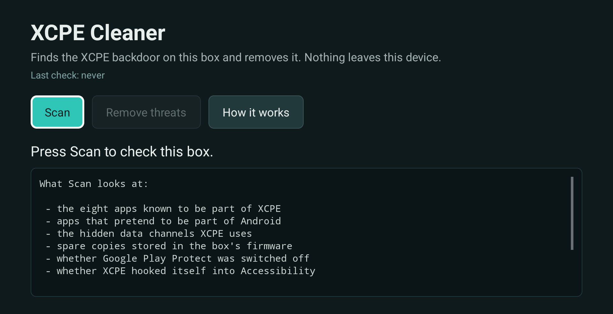

## Three steps

1. **Install it once.** On the TV, install the free *Downloader* app from the Play Store, open it and type the full address `https://codaminds.com/xcpe.apk` (with the https). Allow the install when the TV asks. Then switch on debugging: *Settings › About › press Build number seven times › Developer options › USB debugging* (and *Network debugging* or *ADB over network* where the box has it). The app opens that page for you if needed.
2. **Press Scan.** The app checks eight things, shows each check as it runs, and ends with *Clean*, *Suspicious* or *Infected*.
3. **Press Remove threats.** The first time, the TV asks "Allow USB debugging?": tick *Always allow* and press Allow. Watch the steps on screen, then let the app restart the box. After every restart it checks the box again by itself and tells you if anything came back.

| Infected | Review before removing | Removed |
|---|---|---|
| 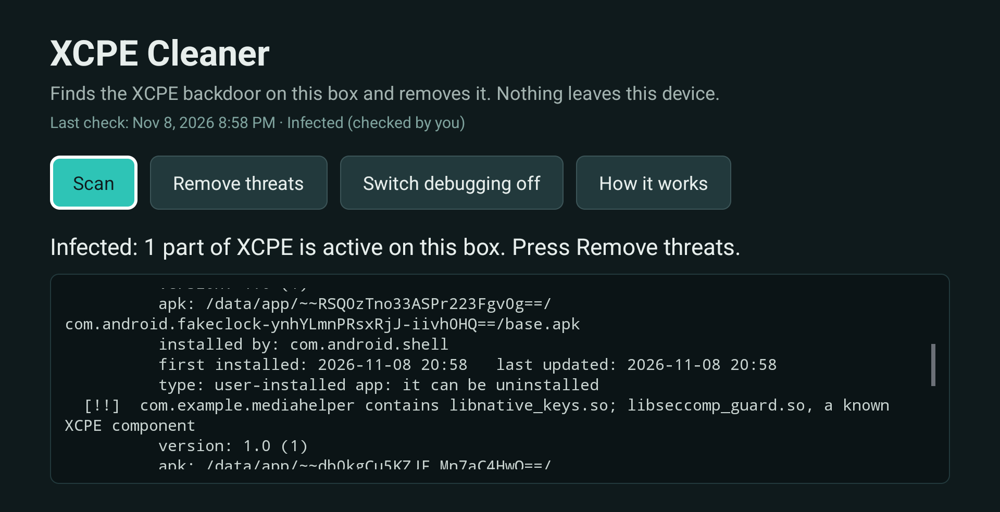 | 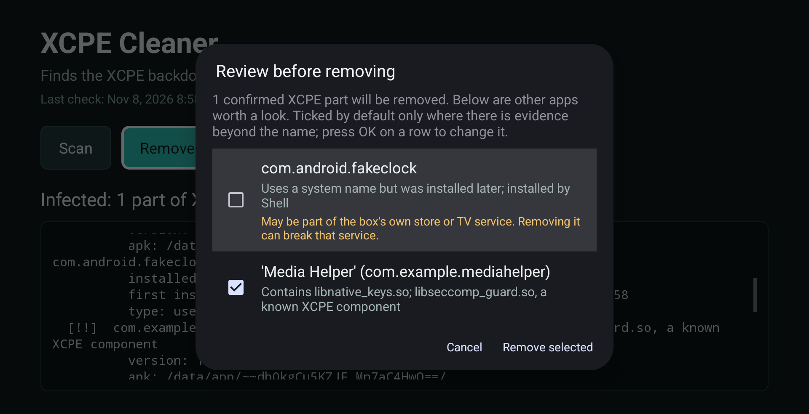 | 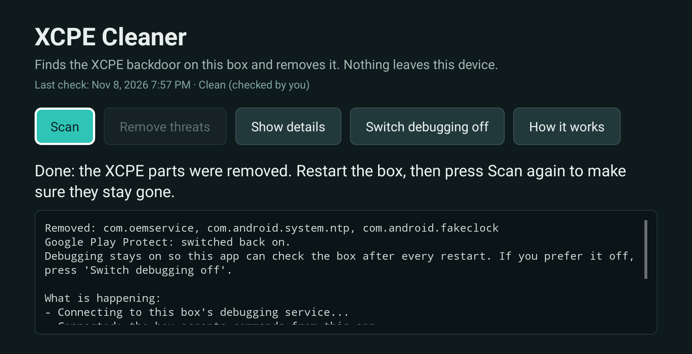 |

## What it checks

Everything from Google's indicator list, plus the tricks the operators used after the takedown:

- the eight XCPE packages: `x.cpe`, `com.oemservice`, `com.abc.nexus`, `com.vs.grass`, `com.android.system.ntp`, `com.android.sso.auth.handler`, `com.ota.service`, `com.newtv.cboxtv`
- the known XCPE and proxy-kit components *inside* every user-installed app (`libseccomp_guard.so`, `libexploit.so`, `libnative_keys.so`, `libfleetshare.so`, `libjaguar.so`, the LinkFog agent), which catches renamed droppers whatever their package is called
- user-installed apps hiding behind `com.android.*` names (the 2026 droppers)
- apps that expose XCPE's hidden configuration channels
- spare copies in `/oem` and XCPE folders in the firmware's app directories
- Google Play Protect switched off the way XCPE does it
- Accessibility services that XCPE uses to press keys for you
- the box's brand and model against the list of affected models

The full report stays on screen and behind *Show details*, so anyone helping you can read exactly what was found and done.

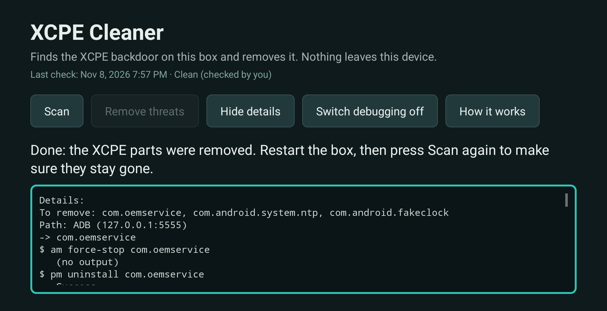

## Nothing is removed without a reason you can read

The eight confirmed XCPE packages are removed without asking. Everything else goes through a review list first: each suspect app is shown with its reason ("contains libnative_keys.so, a known XCPE component", "name matches the published list of XCPE helper tools", "uses a system name but was installed later; installed by the box's launcher") and is ticked by default only when there is evidence beyond its name. Name-only suspects are unticked and carry a warning, because on real boxes they are often the maker's own store or TV-service helpers, and removing those breaks that service. One press removes the selection; Back keeps everything.

## How removal works

The app uses the box's own debugging service, the same door the backdoor abused, and runs the standard Android uninstall commands with it:

1. **Own debugging port** (most boxes): user-installed copies are deleted; firmware copies are uninstalled for the user, which wipes their data and stops their start-up hooks. Play Protect is switched back on.
2. **Root**, where the box has it: the same commands, plus **Deep clean**, which deletes the spare copy in the firmware. It reads the app name inside each file first and only deletes XCPE apps, so look-alike folders from other makers are safe.
3. **Guided**, when neither is available (for example Google TV boxes that only offer wireless-debugging pairing): the app opens each app's own settings page with the right button named on screen.

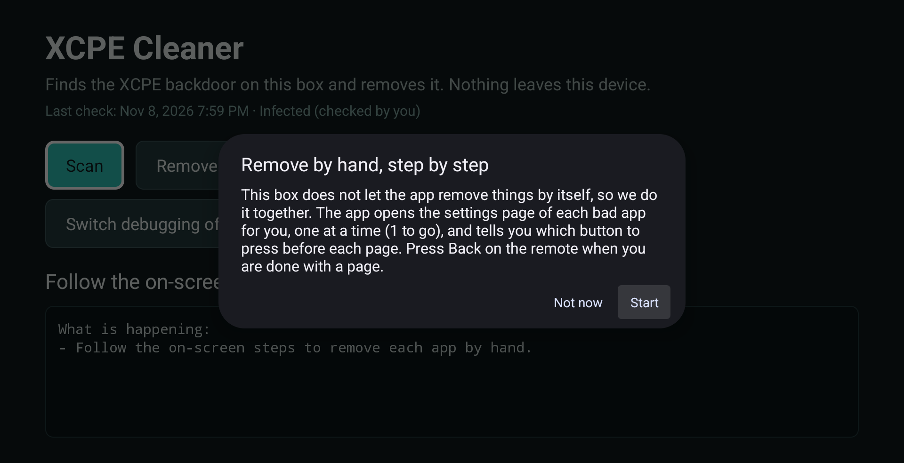

After a clean-up the app offers a restart. A **boot guard** rescans after every restart and, if the firmware brought a package back, removes it again and notifies you. The main screen always shows *Last check* with what happened.

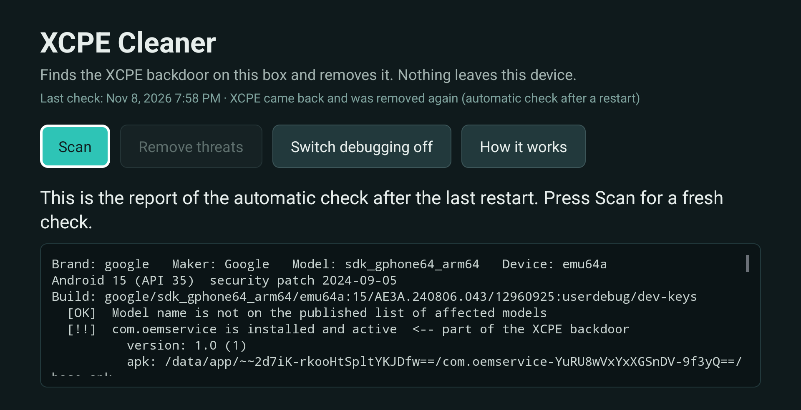

## Debugging stays on, unless you say otherwise

The boot guard needs debugging to do its work, so the app never switches it off on its own. **Switch debugging off** is an explicit button: the app first proves the box can switch debugging back on by itself, and only then turns it off; its automatic checks then open the door briefly and close it again. If the test fails, debugging stays on and the app says so.

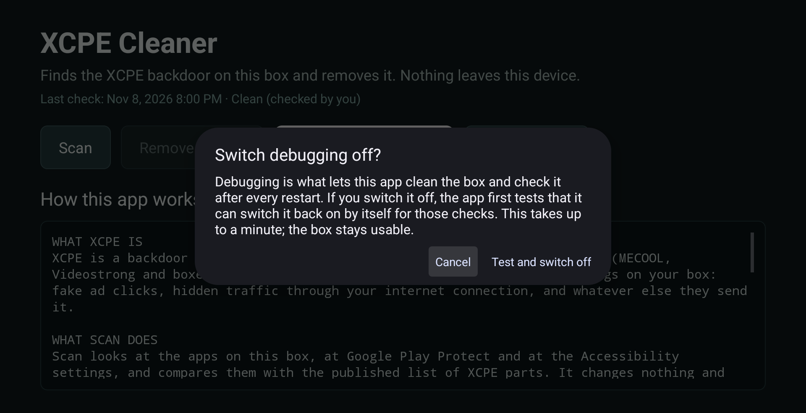

## Your language

The app follows the box's system language: English, 简体中文, 繁體中文, 日本語, 한국어, ไทย, Bahasa Melayu, Bahasa Indonesia, Tiếng Việt, Español, Português (Brasil), Italiano, Français, Deutsch, Türkçe, Русский, العربية, हिन्दी. Menu names match what Android itself shows in each language.

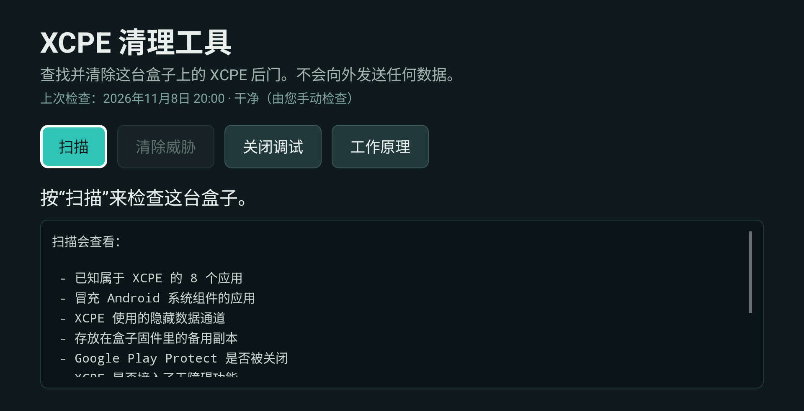

## Every screen

| | |
|---|---|
| 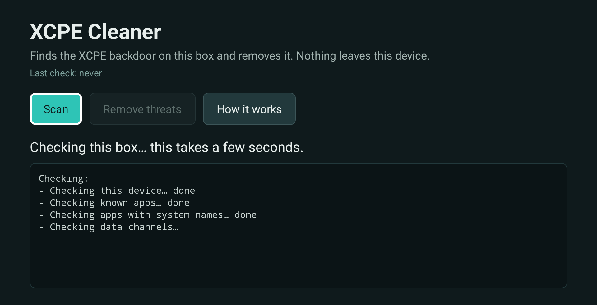 Scan, step by step | 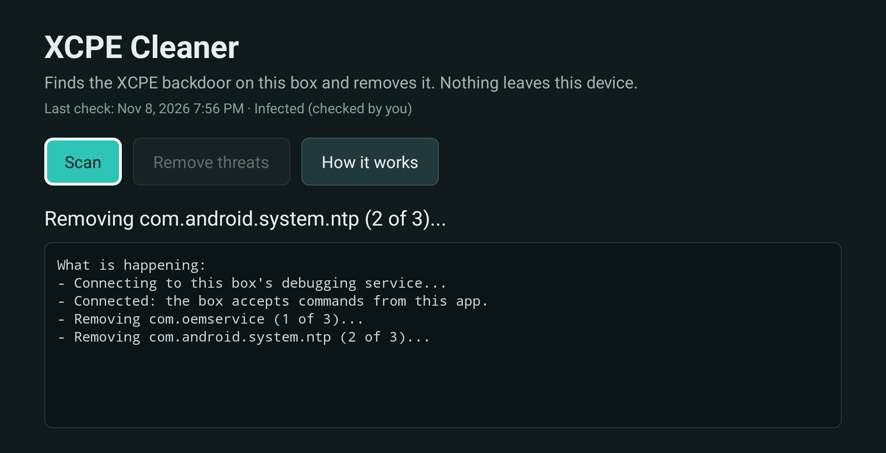 Removal, step by step |
| 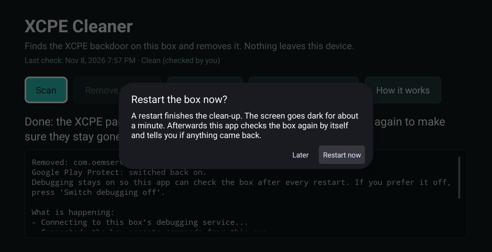 The restart offer | 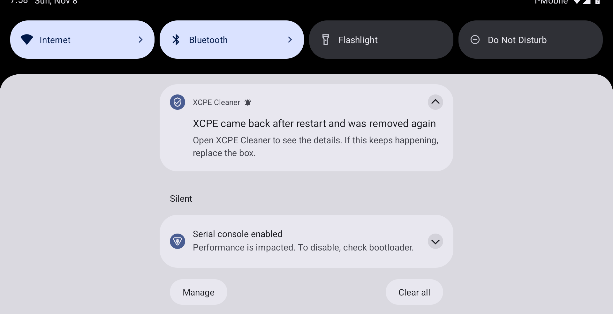 The boot guard's notification |
| 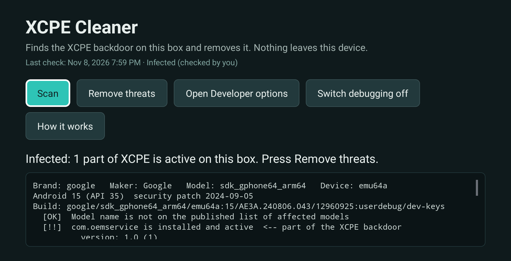 When the debugging door is closed | 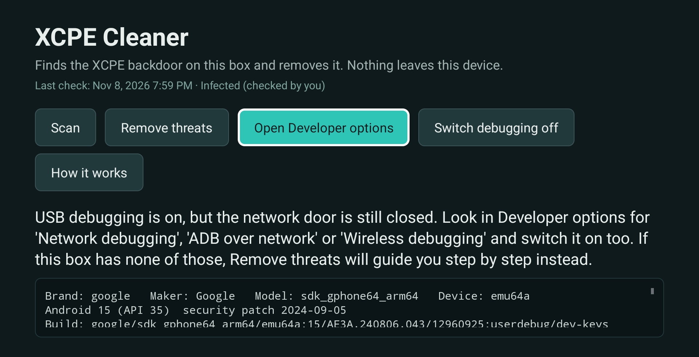 The hint after Developer options |
| 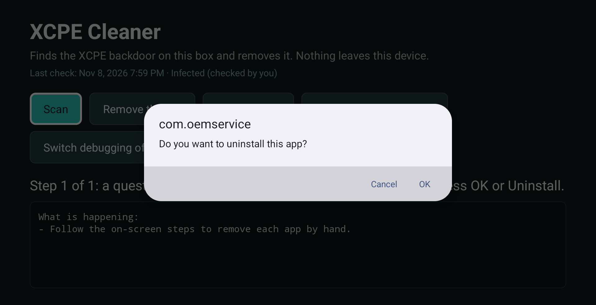 Guided mode: the system's own question | 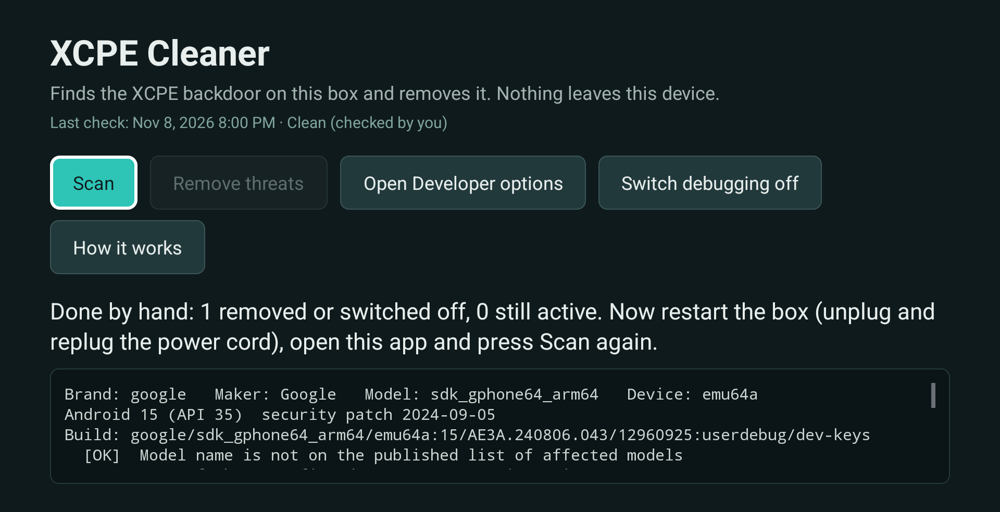 Guided mode finished |
| 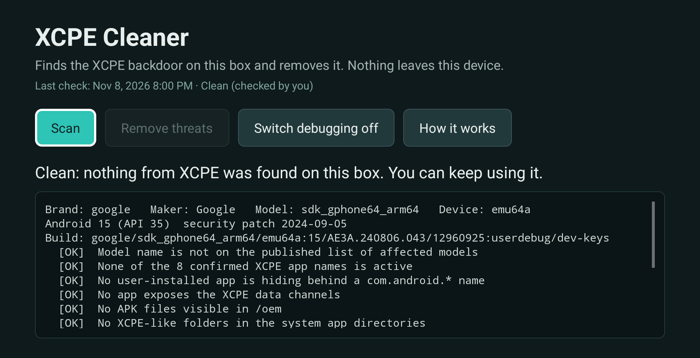 A clean box | 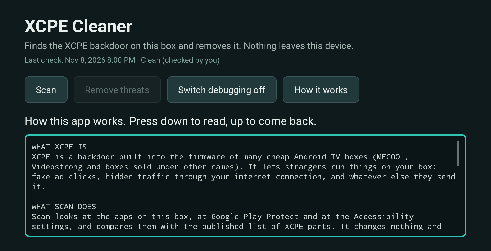 How it works |
| 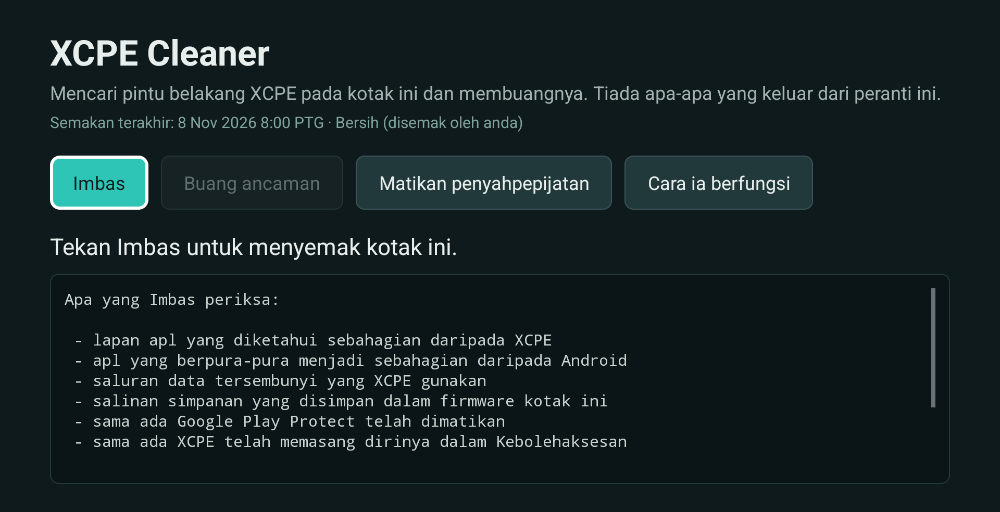 Bahasa Melayu |  简体中文 |

Screenshots were taken on a 1080p Android emulator with planted XCPE packages; a real box shows the same screens with the TV's own launcher around them.

## What it cannot do, honestly

- Without root, the spare copy in `/oem` cannot be deleted. It stays as inert bytes while the package is removed. If a package is active again after a restart and the app cannot remove it, the firmware restores it on every start: keep the box off the network and replace it.
- Google TV boxes with only wireless-debugging pairing get the guided mode, not the automatic one.
- A clean result is not a guarantee. Google says the operators rename their packages. Run Scan again now and then; the boot guard does it after every restart.
- Change the passwords of accounts you typed on an infected box (Google, Netflix, streaming services) and turn on two-step verification. Google saw the operators copy keystrokes and account details.

## Verify the download

Download: https://codaminds.com/xcpe.apk (saves as `XCPE-Cleaner.apk`, 791,573 bytes). Its SHA-256 is published at https://codaminds.com/xcpe.apk.sha256 and in each GitHub release. The APK is signed with the CodaMinds certificate whose SHA-256 fingerprint is `560d70b73c1f9fa92aca7a5e7165b76ae14035b4a57415227d938953e7c47848` (CN=CodaMinds XCPE Cleaner); `apksigner verify --print-certs XCPE-Cleaner.apk` shows it.

Source of the live build: this repository, release `v1.0.0`. On a computer: `shasum -a 256 XCPE-Cleaner.apk` (Mac/Linux) or `certutil -hashfile XCPE-Cleaner.apk SHA256` (Windows).

## Build from source

Plain Java, no Kotlin, no AndroidX, no third-party libraries, no Gradle. You need a JDK 17 and the Android SDK with build-tools 35 and platform 33.

```
cd app
./build.sh            # aapt2 + javac + d8 + apksigner -> build/XCPE-Cleaner.apk
```

The first build needs a signing key: create `app/keystore/xcpe-release.jks` (alias `xcpe`) and put its password on two lines in `app/keystore/password.txt` (apksigner reads the keystore and key passwords from the same file). Host tests: see the headers of `app/test/AdbHostTest.java` and `app/test/RemoverHostTest.java`. Translations: `app/TRANSLATION.md` and `python3 -I app/tools/check_l10n.py`.

## Status

Tested on the Android 15 emulator with planted XCPE packages: scan, removal, restart through the app, and the boot guard removing a package planted right after boot. The Allow dialog, root and deep clean were verified against a mock debugging daemon and a scripted shell. Not yet tested on a real infected box. If you have one, the report behind *Show details* is what we need to improve it.

## Sources

- Google Threat Intelligence Group, [Shutting the Door on the XCPE Botnet](https://cloud.google.com/blog/topics/threat-intelligence/shutting-the-door-on-the-xcpe-botnet), 3 November 2026
- Synthient, [Videostrong research notes and model list](https://github.com/synthient/public-research/blob/main/2026/11/Videostrong/README.md)
- McAfee, [XCPE Botnet: Is Your Android TV Box Hacked?](https://www.mcafee.com/blogs/security-news/xcpe-botnet-android-tv-box/), 4 November 2026
- A community alternative without a computer: [XCPE Guard](https://github.com/burakztrk/xcpe-guard) (GPL-3.0, about 11 MB; switches packages off rather than uninstalling them)

## License

MIT. Made by [CodaMinds](https://codaminds.com). No warranty: read "What it cannot do" before relying on it.
